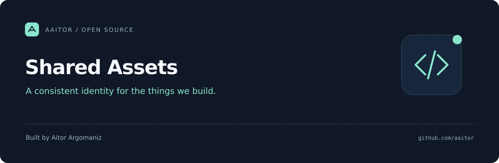

<p align="center"></p>

# Shared Assets

Reusable visual components for [Aitor Argomaniz's open-source projects](https://github.com/aaitor): project banners, social cards, README components, and a terminal recording theme. Original assets and helper code are MIT licensed.

## Browse the library

| Directory | Contents |
| --- | --- |
| [banners/](banners/) | 1280 × 420 project headers, including the OSS template banner |
| [social/](social/) | 1280 × 640 social-card sources and PNG exports |
| [brand/tokens.json](brand/tokens.json) | Shared palette and font choices |
| [components/](components/) | Copyable README header and author footer |
| [terminal/theme.tape](terminal/theme.tape) | Navy-and-mint VHS terminal style |
| [scripts/](scripts/) | Standard-library SVG generator and source validation |

## Generate a banner for a project

Clone this repository, then run:

```bash
python3 scripts/banner.py --repo my-tool --title "My Tool" \
  --tagline "Make everyday work a little easier."
python3 scripts/check.py
```

This writes `banners/my-tool.svg` and `social/my-tool.svg`. Keep titles at most 32 characters and taglines at most 76. Review the artwork and commit both files. Existing files with the same repository name are replaced; review your working tree first.

Export social SVGs to PNG with a vector editor or CairoSVG. GitHub social-preview images must be uploaded through repository Settings; linking to a file does not configure them.

## Share a banner across repositories

Use the raw asset URL in a README image. Replace `COMMIT_SHA` with the full commit SHA that contains the asset:

```html

```

Prefer a commit SHA for predictable rendering. Using `main` opts into future edits for every consumer and may still be cached by GitHub. Published paths should stay stable. For offline documentation or independent projects, copy the file locally and record its source revision. Preserve the MIT notice when redistributing substantial portions.

## Use the terminal theme

Copy `terminal/theme.tape` into your project, record the source commit, and import the local file from a VHS tape:

```text
Source examples/terminal-demo/theme.tape
```

See the [template's recording tutorial](https://github.com/aaitor/oss-repo-template/blob/main/docs/terminal-demo.md) for a runnable example and complete recording instructions. Store project-specific demonstrations in the project repository; this library holds the reusable visual components.

## Contributing and license

See [CONTRIBUTING.md](CONTRIBUTING.md), [CODE_OF_CONDUCT.md](CODE_OF_CONDUCT.md), and [SECURITY.md](SECURITY.md). Original artwork, documentation, and code use [MIT](LICENSE). You can adapt the branding; do not imply endorsement. Third-party fonts/tools retain their own licenses and are not bundled here.
